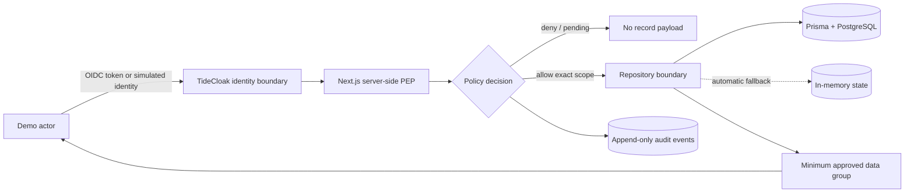

<div align="center">

# GuardianGate

**Zero-trust access control for pediatric health records**

*No identity, not even an administrator, holds a master key to a child's medical record.*


[Quick start](#quick-start) · [How it works](#how-it-works) · [Demo walkthrough](#demo-walkthrough) · [API reference](#api-reference) · [Project status](#project-status)

</div>

---

GuardianGate decides every protected read **on the server**. Each decision uses the authenticated actor, the care relationship, the stated purpose, the approved data groups, independent approvals and an expiry. TideCloak provides the OIDC identity boundary. GuardianGate is the **Policy Enforcement Point (PEP)**: it releases only the minimum data a policy authorizes and records every decision in an append-only audit trail.

> [!IMPORTANT]
> GuardianGate is a demonstration prototype built on **synthetic data only**. It is not a production EHR, a legal or compliance certification, or a substitute for clinical emergency procedures.

## Table of contents

- [Quick start](#quick-start)
- [Why GuardianGate](#why-guardiangate)
- [How it works](#how-it-works)
- [Demo personas](#demo-personas)
- [Demo walkthrough](#demo-walkthrough)
- [API reference](#api-reference)
- [Identity: TideCloak and demo simulation](#identity-tidecloak-and-demo-simulation)
- [Running locally](#running-locally)
- [Configuration](#configuration)
- [Testing and validation](#testing-and-validation)
- [Project status](#project-status)
- [Repository layout](#repository-layout)
- [Security boundaries and limitations](#security-boundaries-and-limitations)
- [Troubleshooting](#troubleshooting)
- [Documentation](#documentation)

## Quick start

The fastest path needs no Docker or TideCloak. It uses the in-memory store and simulated TideCloak identities.

```powershell
npm ci
Copy-Item .env.example .env
# In .env set: GUARDIANGATE_STORE=memory
npm run dev
```

Open <http://localhost:3000> and choose a persona from the account switcher in the header. To persist data across restarts, see [Prisma + PostgreSQL](#option-a-prisma--postgresql-recommended).

## Why GuardianGate

With conventional role-based access, `admin` often means unrestricted access. That is especially dangerous for children's health information: a legitimate user may be outside the active care episode, may request more data than needed, or may try to bypass consent.

GuardianGate replaces implicit trust with explicit, time-bound evidence:

| Risk | GuardianGate control |
| --- | --- |
| A clinician browses a child outside their care episode | An ordinary request needs an active consultation assignment |
| A pending request leaks record contents | The API returns policy state only; no record data is included |
| A broad approval unlocks the full chart | Each grant is bound to one child, one purpose, specific data groups and an expiry |
| One guardian releases data to a third party | Every verified guardian (two in the demo) must approve an external share |
| "Emergency" becomes a universal bypass | Two distinct doctors are required; only the minimum summary is released, briefly |
| An admin weakens the rules or self-grants access | Admins can only propose. Privacy and Compliance must approve independently, and admins still cannot read patient data |
| Evidence is edited after the fact | Audit events are append-only and shown through role-scoped views |

## How it works



The enforcement boundary sits behind the UI on purpose, because hiding a button is not authorization. Every protected route:

1. **Derives identity** from a verified TideCloak token, or from a simulated TideCloak session in demo mode. It never trusts a client-supplied role.
2. **Evaluates authoritative policy state** (relationship, purpose, scope, approvals, expiry, revocation) before touching record content.
3. **Fails closed** when any piece of evidence is missing, and returns a machine-readable `reason`.
4. **Writes an audit event** for the attempt and its outcome, including denials.

### The five policy lanes

| Lane | Required quorum | What can be released |
| --- | --- | --- |
| Ordinary consultation | Assigned doctor in an active consultation + 1 verified guardian | Only the requested groups, until the grant expires or the consultation ends |
| External sharing | All verified guardians (2 in the demo) | Only the approved recipient, purpose, scope and duration |
| Emergency break-glass | 2 distinct doctors | Minimum clinical summary for a short window (default 30 min), with a mandatory post-event review |
| Sensitive policy change | Privacy Officer + Compliance Approver (distinct people) | The new policy, which takes effect only at quorum; the previous policy stays active until then |
| Audit | Role-specific visibility | The metadata each role needs. Never a back door to clinical content |

Some product invariants are **not changeable**, even when a proposal reaches quorum: no admin record access, no global grants, guardian consent, two-guardian sharing, two-doctor emergency access, Privacy + Compliance quorum, and append-only audit. A proposal that touches any of them is rejected when quorum is reached.

## Demo personas

All identities are synthetic and deterministic. They map to the same subjects in the PostgreSQL seed and in the in-memory store.

| Persona | Subject | Realm role | Role in the walkthrough |
| --- | --- | --- | --- |
| BS. An Nguyễn | `demo-doctor-a` | `doctor` | Assigned doctor; creates ordinary and emergency requests |
| BS. Bình Trần | `demo-doctor-b` | `doctor` | Independent second doctor for break-glass |
| BS. Chưa phân công | `demo-doctor-unassigned` | `doctor` | Proves the active-consultation boundary |
| Giám hộ An | `demo-guardian-a` | `guardian` | Ordinary approval; first external-share approval |
| Giám hộ Bình | `demo-guardian-b` | `guardian` | Second independent external-share approval |
| Privacy Officer | `demo-privacy` | `privacy_officer` | Reviews emergency events; approves policy proposals |
| Compliance Approver | `demo-compliance` | `compliance_approver` | Completes the policy-change quorum |
| Quản trị viên | `demo-admin` | `admin` | Proposes policy changes; proves there is no patient-data override |

The seed contains one child (`40000000-0000-4000-8000-000000000001`, *Minh Anh*), one active consultation that Doctors A and B are assigned to, four record groups (`summary`, `encounter`, `diagnostic`, `sensitive`) and one pending ordinary request.

## Demo walkthrough

Start from a fresh seed (`POST /api/v1/demo/reset`). At every step, show the policy result **and** the matching audit event: a green UI state alone is not evidence.

<details open>
<summary><strong>1. Ordinary consultation: one guardian approval</strong></summary>

1. As **Unassigned doctor**, try to open the child's record. Access is denied (`not_assigned`) and no record fields are returned.
2. As **Dr. An**, request the `encounter` group for a stated treatment purpose.
3. Try to open the record while the request is `pending`. The record stays locked and the response lists `guardian_approval` as missing.
4. As **Guardian An**, approve the request.
5. As **Dr. An**, open the record again. Only `encounter` is returned, until expiry. Asking for `sensitive` is denied (`group_not_granted`).

**Evidence:** actor, consultation assignment, purpose, approved scope, expiry, and the denied/pending/granted audit events.
</details>

<details>
<summary><strong>2. External sharing: two verified guardians</strong></summary>

1. As **Guardian An**, create an external share for a named recipient, purpose, data group and duration.
2. Record Guardian An's approval. The share stays `pending`, and its released package is `null`.
3. As **Guardian Bình**, approve the same share.
4. Only the approved recipient, purpose, scope and duration take effect, and the package is released.

**Evidence:** two distinct verified guardians, the denial while only one has approved, the exact released scope, and the `external_share_released` event.
</details>

<details>
<summary><strong>3. Emergency break-glass: two independent doctors</strong></summary>

1. As **Dr. An**, give an emergency reason and request break-glass access.
2. Try to open the record, or to self-confirm. Both are blocked (`approval_pending`, `same_doctor`).
3. As **Dr. Bình**, confirm independently.
4. As **Dr. An**, open the record. Only the minimum `summary` is visible, and only for the emergency window.
5. As **Privacy Officer**, open the post-event review queue.

**Evidence:** distinct doctor subjects, the emergency reason, the short expiry, the summary-only response, and the `emergency_review_required` event.
</details>

<details>
<summary><strong>4. Policy change: Privacy + Compliance quorum</strong></summary>

1. As **Administrator**, propose a policy change. A proposal is not an activation.
2. Strongest negative case: propose an admin self-grant. The admin still cannot open the record, cannot approve their own proposal, and the proposal is rejected even at quorum.
3. As **Privacy Officer**, approve a valid proposal. The policy version does not change yet.
4. As **Compliance Approver**, add the second approval. Only now does the new policy version take effect.

**Evidence:** the proposer is not counted as an approver, the old policy stays active before quorum, both approval roles are recorded, and the `policy_activated` event appears.
</details>

<details>
<summary><strong>5. Role-scoped, append-only audit</strong></summary>

1. Open the audit log as a doctor, a guardian, the Privacy Officer, the Compliance Approver and the administrator.
2. Each role sees only what its duties require. The admin view is a technical log with no child identity, purpose or emergency reason.
3. Trace the request, decision, grant, access, expiry/revocation, emergency review and policy-activation events from the previous scenarios.
4. `PUT`, `PATCH` and `DELETE` on the audit endpoint return `405`.
</details>

## API reference

Base path: `/api/v1`. All protected endpoints authenticate server-side. See [Identity](#identity-tidecloak-and-demo-simulation) for how a session is presented.

### Identity and demo control

| Method | Path | Description |
| --- | --- | --- |
| `GET` | `/health` | Readiness, TideCloak issuer reachability and the active store (`persistence.active`) |
| `GET` | `/me` | Current actor: `subject`, `username`, `roles`, `simulated` |
| `GET` | `/demo/personas` | Persona catalogue and the current simulated actor |
| `POST` | `/demo/personas` | Switch persona: `{ "persona": "demo-doctor-a" }`. Sets the session cookie and returns a simulated token and claims |
| `DELETE` | `/demo/personas` | Sign out of the simulated session |
| `POST` | `/demo/reset` | Restore the deterministic seed |
| `POST` | `/demo/clock` | Move time forward only: `{ "advanceMinutes": 61 }`. Used to demonstrate expiry |

### Access flows

| Method | Path | Who | Description |
| --- | --- | --- | --- |
| `GET` | `/children` | doctor, guardian | Children linked to the actor |
| `GET` | `/requests?kind=&childId=` | doctor, guardian, privacy, compliance | Requests visible to the actor, with `missingApprovals` |
| `POST` | `/requests` | doctor | Ordinary request: `{ childId, consultationId?, recordGroups, purpose, durationMinutes }` |
| `GET` | `/requests/{id}` | as above | A single request |
| `POST` | `/requests/{id}/decide` | guardian, or second doctor for emergencies | `{ "decision": "approved" \| "rejected", "note"? }` |
| `POST` | `/requests/{id}/revoke` | guardian, requester, privacy | Revoke a pending or active grant |
| `GET` | `/records/{childId}?groups=` | doctor with an active grant | Returns **only** the granted groups |
| `GET` / `POST` | `/external-share` | guardian | List or create: `{ childId, recipientName, recordGroups, purpose, durationMinutes }` |
| `GET` | `/external-share/{id}` | guardian, privacy | Status, plus `released`, which stays `null` until all verified guardians approve |
| `GET` / `POST` | `/emergency` | doctor | List or create: `{ childId, reason }`. Scope is always `summary` |
| `POST` | `/emergency/{id}/confirm` | a different doctor | Independent confirmation |
| `GET` | `/emergency/review` | privacy | Post-event review queue |

### Governance and audit

| Method | Path | Who | Description |
| --- | --- | --- | --- |
| `GET` | `/policy-proposals` | admin, privacy, compliance | Active policy, version history and proposals |
| `POST` | `/policy-proposals` | admin | `{ changeType, proposedValue, rationale? }`. `changeType` is one of `access_duration`, `emergency_window`, `data_scope`, `governance_rule` |
| `POST` | `/policy-proposals/{id}/decide` | privacy, compliance | `{ "decision": "approved" \| "rejected" }` |
| `GET` | `/audit?childId=&requestId=&type=` | every role, each with its own scope | Role-scoped, append-only event log |

### Response format

Success:

```json
{ "success": true, "data": { "...": "..." } }
```

Denial, which never contains record content:

```json
{
  "success": false,
  "error": {
    "code": "FORBIDDEN",
    "message": "No active grant for this child; record remains locked.",
    "requestId": "7ed09981-…",
    "details": { "reason": "approval_pending", "missingApprovals": ["guardian_approval"] }
  }
}
```

Common `reason` values: `unauthenticated`, `not_assigned`, `approval_pending`, `self_approval`, `same_doctor`, `group_not_granted`, `expired`, `revoked`, `rejected`, `admin_no_override`, `proposer_cannot_approve`, `duplicate_role_approver`, `duration_exceeds_policy`.

## Identity: TideCloak and demo simulation

GuardianGate is built as though TideCloak protects it. The TideCloak OIDC architecture is unchanged: the public adapter [`tidecloakAdapter.json`](tidecloakAdapter.json), the realm `guardiangate` and the public client `guardiangate-web`. Until real Tide enrollment is complete (see [Project status](#project-status)), the app can simulate TideCloak sign-in, roles and access checks.

The server resolves the actor in this order:

1. **`Authorization: Bearer <token>`, or the `kcToken` cookie**
   - A real JWT is verified against the TideCloak realm.
   - A simulated token (`demo.<persona>`) is resolved locally.
2. **`x-demo-persona` header**, for scripts and tests.
3. **`gg_demo_persona` cookie**, which the persona switcher sets.

Simulated sessions carry the same claim shape that TideCloak issues: `iss` (`http://localhost:8080/realms/guardiangate`), `azp` (`guardiangate-web`), `sub`, `preferred_username` and `realm_access.roles`, plus an explicit `tide_simulated: true` marker.

Guarantees:

- **An invalid real token never falls back to a demo persona.**
- **Simulation is disabled** when `NODE_ENV=production` or `GUARDIANGATE_DEMO_AUTH=off`. The `/demo/*` endpoints then return `404`.
- Policy code sees one `TideActor` type, whether the token is real or simulated, so enforcement does not change when real TideCloak is connected.

### Real TideCloak realm settings

| Setting | Value |
| --- | --- |
| Issuer | `http://localhost:8080/realms/guardiangate` |
| Public client | `guardiangate-web` |
| Redirect URI | `http://localhost:3000/auth/redirect` |
| Web origin | `http://localhost:3000` |
| Realm roles | `doctor`, `guardian`, `admin`, `privacy_officer`, `compliance_approver` |

### Sign in with a real TideCloak account (local)

```powershell
docker compose up -d tidecloak     # TideCloak Dev on http://localhost:8080 (console: admin / password)
npm run tidecloak:provision        # realm, client, roles, ES256 signing key, 8 demo users
```

Open <http://localhost:3000/auth/login> (or **🔐 Sign in with TideCloak** in the header) and sign in with any persona username, for example `demo-doctor-a`, and the local password `demo1234`. The browser stores the access token in the `kcToken` cookie; every API call is then verified against the realm, and the header shows *Signed in with TideCloak*. Sign out on `/auth/login` to return to the persona switcher.

> [!NOTE]
> A verified realm user whose username matches a seeded persona acts as that seeded user, because the synthetic seed keys relationships by persona username. The real `sub` UUID is kept in the claims. Any other realm user fails closed, since they have no relationship to the demo child. `@tidecloak/verify` accepts only ES256/ES384/ES512/EdDSA tokens, which is why the provisioning script adds an ES256 key. Completing Tide account enrollment later switches the realm to Tide's EdDSA key.

## Running locally

### Prerequisites

- Node.js **24 or newer** and npm
- Docker Desktop, for PostgreSQL and TideCloak Dev (optional; the app falls back to memory and simulated identities)

### Option A: Prisma + PostgreSQL (recommended)

```powershell
npm ci
Copy-Item .env.example .env
docker compose up -d postgres
npm run prisma:generate
npx prisma migrate deploy
npm run db:seed
npm run dev
```

PostgreSQL is exposed on `localhost:5434`, which avoids the common `5432` collision. The seed is repeatable.

### Option B: In-memory store

Set `GUARDIANGATE_STORE=memory` in `.env` and run `npm run dev`. The same personas and policy states boot in process; restarting the server resets them.

> [!TIP]
> In `postgres` mode the app **falls back to memory automatically** when the database is unreachable or not seeded, so the demo never crashes. Before you present, check `persistence.active` in `GET /api/v1/health`.

## Configuration

All values are local demo settings; see [`.env.example`](.env.example). Never put real credentials, tokens or patient data in `.env`.

| Variable | Default | Purpose |
| --- | --- | --- |
| `NODE_ENV` | `development` | Runtime mode. `production` disables simulated identities |
| `DATABASE_URL` | local Compose database | PostgreSQL connection used by Prisma |
| `GUARDIANGATE_STORE` | `postgres` | `postgres` (with automatic memory fallback) or `memory` |
| `GUARDIANGATE_DEMO_AUTH` | `true` | Simulated TideCloak sessions; set to `off` to require real tokens |
| `TIDECLOAK_URL` | `http://localhost:8080` | TideCloak issuer base URL |
| `TIDECLOAK_REALM` | `guardiangate` | Realm name |
| `TIDECLOAK_CLIENT_ID` | `guardiangate-web` | Public PKCE client |
| `TIDE_POLICY_CONTRACT_ID` | *(empty)* | Forseti policy contract ID, generated after contract deployment |

## Testing and validation

```powershell
npm test            # unit + acceptance suite
npm run typecheck
npm run lint
npm run build
```

The acceptance suite (`tests/demo-validation.test.ts`) covers the eight minimum checks in [GuardianGate demo validation](.agents/skills/guardiangate-demo-validation/SKILL.md):

| # | Scenario | Defect class guarded |
| --- | --- | --- |
| 1 | Doctor outside the active consultation is denied | policy bypass |
| 2 | Record stays locked while approval is pending | policy bypass |
| 3 | One guardian unlocks only the approved group | scope leak |
| 4 | External share needs both verified guardians | policy bypass / scope leak |
| 5 | Emergency needs a distinct doctor; summary only | policy bypass / scope leak |
| 6 | Admin proposal changes nothing before Privacy + Compliance quorum | policy bypass |
| 7 | Expired and revoked grants are denied | state / expiry defect |
| 8 | Audit is immutable and viewer-scoped | audit defect |

`tests/tide-simulation.test.ts` checks the simulated TideCloak claims, role enforcement, and that simulation is disabled in production or when `GUARDIANGATE_DEMO_AUTH=off`. To run the database integration test after migrating and seeding PostgreSQL:

```powershell
$env:RUN_DATABASE_TESTS='1'; npm test
```

A build is **not demo-ready** if any test reports a `policy bypass` or a `scope leak`. Database-backed and in-memory modes must satisfy the same policy contract.

## Project status

| Area | Status |
| --- | --- |
| Product, architecture and database specifications | ✅ Approved |
| PostgreSQL schema, migration and synthetic seed | ✅ Done |
| Policy enforcement for all five lanes (server-side) | ✅ Done; covered by the acceptance suite |
| Role-scoped, append-only audit | ✅ Done at the application boundary |
| Persistence with automatic in-memory fallback | ✅ Done |
| Simulated TideCloak sign-in, roles and access checks | ✅ Done |
| Real OIDC sign-in against local TideCloak Dev | ✅ Done (`npm run tidecloak:provision`) |
| Tide account enrollment / license (Tide EdDSA keys) | ⏳ Blocked: `TIDE-001` |
| Forseti policy contract and QEA governed writes | ⏳ Planned: `BE-005` |
| OpenAPI contract | ⏳ Planned: `BE-006` |

Delivery details and blockers are tracked in [docs/backend/plan.md](docs/backend/plan.md).

## Repository layout

```text
app/                    Next.js UI and /api/v1 route handlers
server/auth/            TideCloak verification, demo personas, simulated sessions
server/policy/          Deny-by-default policy service, demo state, append-only audit
server/repositories/    Prisma persistence and automatic in-memory fallback
server/api/             Response envelope and authenticated route helper
prisma/                 Schema, migration and deterministic synthetic seed
tests/                  Unit, simulation and demo acceptance tests
docs/                   Product, architecture, database and delivery documents
```

## Security boundaries and limitations

- Authorization happens on the server. Client state and role strings sent by a browser are never accepted as authorization evidence.
- Missing or invalid identity, relationship, purpose, scope, approval, expiry, revocation or approver independence fails closed.
- Ordinary, external-share, emergency and policy-change grants are separate and cannot be reused across flows.
- Record groups are read only after an allow decision. A denied response never contains a hidden full-record payload.
- Expiry and revocation take effect at the next protected access.
- Audit is append-only at the application boundary. This prototype does **not** claim production-grade, immutable-ledger guarantees.
- The prototype cannot prevent screenshots or out-of-band disclosure, and it has not been certified against any jurisdiction's healthcare regulations.

## Troubleshooting

| Symptom | Likely cause and fix |
| --- | --- |
| Every API call returns `401 UNAUTHENTICATED` | No persona selected. Use the account switcher, or send `x-demo-persona: demo-doctor-a` |
| A real login is rejected but personas work | Run `npm run tidecloak:provision`, and sign in with a persona username; other usernames have no seeded relationships |
| `/auth/login` keeps showing *Connecting to TideCloak…* | TideCloak is not running: `docker compose up -d tidecloak` |
| Data disappears after a restart | The app is running on the in-memory store. Start PostgreSQL, migrate and seed |
| `/demo/*` returns `404` | `NODE_ENV=production` or `GUARDIANGATE_DEMO_AUTH=off` |
| `/health` reports `degraded` | TideCloak is not reachable at `TIDECLOAK_URL`. This is expected when running without TideCloak |
| Prisma type errors after `npm ci` | Run `npm run prisma:generate` |

## Documentation

- [Product specification](docs/product/product.md): goals, the five lanes, acceptance criteria
- [Architecture](docs/architecture/architecture.md): TideCloak, Forseti and QEA placement, safeguards
- [Database specification](docs/database/database.md): physical schema and constraints
- [Backend delivery plan](docs/backend/plan.md): task status and blockers
- Policy invariants: [`.agents/skills/guardiangate-policy`](.agents/skills/guardiangate-policy/SKILL.md) and [`guardiangate-enforcement`](.agents/skills/guardiangate-enforcement/SKILL.md)

---

<div align="center">
<sub>GuardianGate · local prototype · synthetic data only · not for clinical use</sub>
</div>
