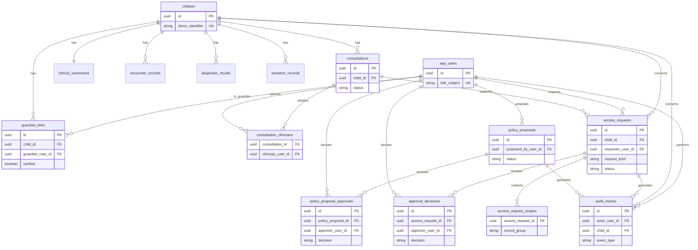

# GuardianGate — Database Specification

## 1. Scope and Sources

**Product:** `docs/product/product.md` — `APPROVED` bởi người dùng, 2026-10-22.  
**Architecture:** `docs/architecture/architecture.md` — được người dùng duyệt trong cuộc trao đổi này; PostgreSQL 16 local.  
**Database engine:** PostgreSQL 16.  
**Existing schema sources:** None — greenfield.

**In scope:** Dữ liệu giả cho child/guardian/consultation/clinical records, yêu cầu và phê duyệt quyền, proposal policy và audit của MVP.

**Out of scope:** Dữ liệu bệnh nhân thật, EHR integration, legal requests, TideCloak realm/client/role configuration, token/secret, và persistence của Forseti/Fabric.

## 2. Resolved Decisions

- Dữ liệu nội dung hồ sơ được tách thành bốn bảng: summary, encounter, diagnostic và sensitive; không dùng một bảng section JSONB chung.
- One-to-many guardian links cho phép một hoặc hai guardian đã xác minh; policy quyết định khi nào cần toàn bộ guardian verified.
- Một bảng request thống nhất giữ common lifecycle cho ordinary access, external share và emergency; scope là một relation riêng vì một request có thể chọn nhiều nhóm dữ liệu.

## 3. Logical Data Model

### User

- **Purpose:** Chủ thể ứng dụng ánh xạ duy nhất từ TideCloak subject, xuất hiện trong relationship, approval và audit.
- **Owner/tenant:** Không multi-tenant trong MVP; identity thuộc TideCloak realm.
- **Identity:** `tide_subject` duy nhất.
- **Lifecycle:** Seed cho demo; không hard delete trong MVP khi đã có audit/reference.
- **Relationships:** Guardian link, consultation assignment, request/proposal/approval/audit actor.
- **Source:** Product 8.1 và Architecture 6.

### Child and guardian link

- **Purpose:** Bệnh nhi giả và relationship hợp lệ để truy cập/approval.
- **Owner/tenant:** Child là subject của record; guardian link thuộc child.
- **Identity:** Child mã demo duy nhất; guardian link duy nhất theo child/user.
- **Lifecycle:** Seed-only cho prototype; không delete khi còn record/history.
- **Relationships:** Child sở hữu records, consultation, requests và audit; guardian link nối child–user.
- **Source:** Product 8.1, 8.2, 8.3.

### Clinical record groups

- **Purpose:** Bốn nhóm dữ liệu được product quy định và cần tách vật lý để không trả toàn hồ sơ mặc định.
- **Owner/tenant:** Mỗi record thuộc một child; encounter/diagnostic có thể thuộc một consultation.
- **Identity:** Một summary/sensitive record theo child; encounter/diagnostic theo record UUID.
- **Lifecycle:** Seed/đọc trong MVP; không public delete path.
- **Relationships:** Child 1:N với các records; consultation 1:N encounter/diagnostic.
- **Source:** Product 6, 8.1 và quyết định database được duyệt.

### Consultation and assignment

- **Purpose:** Chứng minh bác sĩ có quan hệ điều trị đang hoạt động.
- **Owner/tenant:** Consultation thuộc child; assignment thuộc consultation/user.
- **Identity:** Consultation UUID; mỗi user chỉ có một assignment cho mỗi consultation.
- **Lifecycle:** `active`, `completed`, `cancelled`; chỉ active có thể tạo ordinary request.
- **Relationships:** Child 1:N consultation; consultation N:M user qua assignment.
- **Source:** Product 8.2.

### Access request, scope and approval

- **Purpose:** Lưu intent, scope, lifecycle và evidence phê duyệt cho ordinary, external-share, emergency flow.
- **Owner/tenant:** Request thuộc child và requester; scope/approval thuộc request.
- **Identity:** UUID; mỗi scope group một lần/request; mỗi approver một decision/request.
- **Lifecycle:** `pending`, `approved`, `rejected`, `expired`, `revoked`.
- **Relationships:** Request 1:N scopes và 1:N approval decisions; consultation optional (ordinary flow required by application policy).
- **Source:** Product 8.2–8.4.

### Policy proposal and approval

- **Purpose:** Ghi proposal thay đổi policy cục bộ và hai approval nghiệp vụ trước khi đề xuất được coi effective trong app; Tide QEA là governance authority bên ngoài database.
- **Owner/tenant:** Proposal thuộc user proposer; approval thuộc proposal/user.
- **Identity:** UUID; một approver một decision/proposal.
- **Lifecycle:** `proposed`, `approved`, `rejected`, `superseded`.
- **Relationships:** Proposal 1:N approvals.
- **Source:** Product 8.5, Architecture 6.

### Audit event

- **Purpose:** Truy vết request, decision, access, denial, emergency và policy event mà không chứa nội dung bệnh án.
- **Owner/tenant:** Event thuộc actor; may reference child/request/proposal.
- **Identity:** UUID append-only.
- **Lifecycle:** Tạo một lần, không update/delete qua app.
- **Relationships:** N:1 optional user/child/access request/policy proposal.
- **Source:** Product 8.6.

## 4. Mermaid ERD

## 5. Table Specifications

### `app_users`

**MVP justification:** Every workflow needs an auditable actor mapped from Tide identity.  
**Owner/tenant:** Shared demo realm; `tide_subject` is the external identity boundary.  
**Lifecycle:** Seeded, disabled outside app rather than deleted when referenced.

| Column | Engine type | Null | Default | Key | Meaning/source |
|---|---|---|---|---|---|
| `id` | `uuid` | No | `gen_random_uuid()` | PK | Internal actor identity |
| `tide_subject` | `text` | No | None | UQ | TideCloak OIDC `sub` |
| `display_name` | `text` | No | None |  | Demo-visible name |
| `created_at` | `timestamptz` | No | `now()` |  | Audit timestamp convention |

- **Primary key:** `id`.
- **Foreign keys:** None.
- **Unique constraints:** `tide_subject`.
- **Check constraints:** Non-blank `tide_subject`, `display_name`.
- **Indexes:** Unique index backing `tide_subject` (AP-01).
- **Sensitive-data notes:** No credentials, email, token, or role claims stored.

### `children`

**MVP justification:** Records, relationships and requests must be bound to a specific child.  
**Owner/tenant:** Child is the record subject.  
**Lifecycle:** Fake demo data; no deletion in MVP.

| Column | Engine type | Null | Default | Key | Meaning/source |
|---|---|---|---|---|---|
| `id` | `uuid` | No | `gen_random_uuid()` | PK | Child identity |
| `demo_identifier` | `text` | No | None | UQ | Non-real display code |
| `display_name` | `text` | No | None |  | Fake name |
| `date_of_birth` | `date` | No | None |  | Fake demographic context |
| `created_at` | `timestamptz` | No | `now()` |  | Record creation |

- **Primary key:** `id`.
- **Foreign keys:** None.
- **Unique constraints:** `demo_identifier`.
- **Check constraints:** Non-blank display fields; `date_of_birth <= current_date` enforced by application/seed (not CHECK because it is time-dependent).
- **Indexes:** Unique index backing `demo_identifier` (AP-02).
- **Sensitive-data notes:** Fake data only; never seed real children.

### `guardian_links`

**MVP justification:** Ordinary approval and external sharing require verified guardian relationship.  
**Owner/tenant:** Belongs to a child.  
**Lifecycle:** Seeded; relationship must not be hard-deleted while referenced in audit/request history.

| Column | Engine type | Null | Default | Key | Meaning/source |
|---|---|---|---|---|---|
| `id` | `uuid` | No | `gen_random_uuid()` | PK | Link identity |
| `child_id` | `uuid` | No | None | FK | Protected child |
| `guardian_user_id` | `uuid` | No | None | FK | Guardian actor |
| `verified` | `boolean` | No | `false` |  | Demo verification state |
| `created_at` | `timestamptz` | No | `now()` |  | Link creation |

- **Primary key:** `id`.
- **Foreign keys:** `child_id → children(id) RESTRICT`; `guardian_user_id → app_users(id) RESTRICT`.
- **Unique constraints:** `(child_id, guardian_user_id)`.
- **Check constraints:** None.
- **Indexes:** `guardian_links(guardian_user_id, child_id)` (AP-02).
- **Sensitive-data notes:** Relationship data is sensitive; expose only through allowed flows.

### `clinical_summaries`

**MVP justification:** Emergency flow must open only the minimum medical summary.  
**Owner/tenant:** One summary per child.  
**Lifecycle:** Seed/replace only in local demo.

| Column | Engine type | Null | Default | Key | Meaning/source |
|---|---|---|---|---|---|
| `id` | `uuid` | No | `gen_random_uuid()` | PK | Summary identity |
| `child_id` | `uuid` | No | None | FK, UQ | Record subject |
| `allergies` | `text` | No | None |  | Fake emergency content |
| `current_medications` | `text` | No | None |  | Fake emergency content |
| `emergency_notes` | `text` | No | None |  | Fake emergency content |
| `updated_at` | `timestamptz` | No | `now()` |  | Demo data freshness |

- **Primary key:** `id`.
- **Foreign keys:** `child_id → children(id) RESTRICT`.
- **Unique constraints:** `child_id`.
- **Check constraints:** None.
- **Indexes:** Unique index backing `child_id` (AP-05).
- **Sensitive-data notes:** Return only after valid ordinary scope or valid emergency grant.

### `encounter_records`

**MVP justification:** Ordinary scope may include visit notes without opening all records.  
**Owner/tenant:** Belongs to child, optionally associated with a consultation.  
**Lifecycle:** Seeded fake records; no delete path.

| Column | Engine type | Null | Default | Key | Meaning/source |
|---|---|---|---|---|---|
| `id` | `uuid` | No | `gen_random_uuid()` | PK | Record identity |
| `child_id` | `uuid` | No | None | FK | Record subject |
| `consultation_id` | `uuid` | Yes | None | FK | Related consultation when available |
| `diagnosis` | `text` | No | None |  | Fake diagnosis |
| `clinician_note` | `text` | No | None |  | Fake visit note |
| `recorded_at` | `timestamptz` | No | None |  | Clinical timestamp |

- **Primary key:** `id`.
- **Foreign keys:** `child_id → children(id) RESTRICT`; `consultation_id → consultations(id) SET NULL`.
- **Unique constraints:** None.
- **Check constraints:** None.
- **Indexes:** `encounter_records(child_id, recorded_at DESC)` (AP-05).
- **Sensitive-data notes:** Protected group `encounter`.

### `diagnostic_results`

**MVP justification:** Demo needs a separate cận lâm sàng group for scoped access.  
**Owner/tenant:** Belongs to child, optionally a consultation.  
**Lifecycle:** Seeded fake records; no delete path.

| Column | Engine type | Null | Default | Key | Meaning/source |
|---|---|---|---|---|---|
| `id` | `uuid` | No | `gen_random_uuid()` | PK | Result identity |
| `child_id` | `uuid` | No | None | FK | Record subject |
| `consultation_id` | `uuid` | Yes | None | FK | Related consultation |
| `result_type` | `text` | No | None |  | E.g. lab/imaging, fake |
| `result_summary` | `text` | No | None |  | Fake result content |
| `recorded_at` | `timestamptz` | No | None |  | Result time |

- **Primary key:** `id`.
- **Foreign keys:** `child_id → children(id) RESTRICT`; `consultation_id → consultations(id) SET NULL`.
- **Unique constraints:** None.
- **Check constraints:** Non-blank `result_type`.
- **Indexes:** `diagnostic_results(child_id, recorded_at DESC)` (AP-05).
- **Sensitive-data notes:** Protected group `diagnostic`.

### `sensitive_records`

**MVP justification:** Product distinguishes records needing special policy.  
**Owner/tenant:** Belongs to child.  
**Lifecycle:** Seeded fake records; no delete path.

| Column | Engine type | Null | Default | Key | Meaning/source |
|---|---|---|---|---|---|
| `id` | `uuid` | No | `gen_random_uuid()` | PK | Record identity |
| `child_id` | `uuid` | No | None | FK | Record subject |
| `classification` | `text` | No | None |  | Policy category label |
| `content` | `text` | No | None |  | Fake sensitive content |
| `recorded_at` | `timestamptz` | No | None |  | Record time |

- **Primary key:** `id`.
- **Foreign keys:** `child_id → children(id) RESTRICT`.
- **Unique constraints:** None.
- **Check constraints:** Non-blank `classification`.
- **Indexes:** `sensitive_records(child_id, recorded_at DESC)` (AP-05).
- **Sensitive-data notes:** Never returned by emergency route; requires explicit approved scope/policy.

### `consultations`

**MVP justification:** Ordinary doctor access requires active treatment relation.  
**Owner/tenant:** Belongs to child.  
**Lifecycle:** `active`, `completed`, `cancelled`; no new ordinary grant after non-active status.

| Column | Engine type | Null | Default | Key | Meaning/source |
|---|---|---|---|---|---|
| `id` | `uuid` | No | `gen_random_uuid()` | PK | Consultation identity |
| `child_id` | `uuid` | No | None | FK | Patient child |
| `status` | `consultation_status` | No | `'active'` |  | Lifecycle state |
| `starts_at` | `timestamptz` | No | None |  | Start time |
| `ends_at` | `timestamptz` | Yes | None |  | End time |

- **Primary key:** `id`.
- **Foreign keys:** `child_id → children(id) RESTRICT`.
- **Unique constraints:** None.
- **Check constraints:** `ends_at IS NULL OR ends_at >= starts_at`.
- **Indexes:** `consultations(child_id, status, starts_at DESC)` (AP-03).
- **Sensitive-data notes:** Contains no content record.

### `consultation_clinicians`

**MVP justification:** Must prove requester doctor is assigned to consultation.  
**Owner/tenant:** Belongs to consultation.  
**Lifecycle:** Assignment ends with consultation; no hard delete when historical request refers to consultation.

| Column | Engine type | Null | Default | Key | Meaning/source |
|---|---|---|---|---|---|
| `consultation_id` | `uuid` | No | None | PK, FK | Consultation |
| `clinician_user_id` | `uuid` | No | None | PK, FK | Assigned clinician |
| `assigned_at` | `timestamptz` | No | `now()` |  | Assignment time |

- **Primary key:** `(consultation_id, clinician_user_id)`.
- **Foreign keys:** `consultation_id → consultations(id) RESTRICT`; `clinician_user_id → app_users(id) RESTRICT`.
- **Unique constraints:** Primary key.
- **Check constraints:** None.
- **Indexes:** `consultation_clinicians(clinician_user_id, consultation_id)` (AP-03).
- **Sensitive-data notes:** Treatment relationship is sensitive.

### `access_requests`

**MVP justification:** Ordinary, external sharing and emergency flows need a policy-bound request lifecycle.  
**Owner/tenant:** Belongs to child and requester.  
**Lifecycle:** `pending → approved|rejected`; active authority can become `expired|revoked`.

| Column | Engine type | Null | Default | Key | Meaning/source |
|---|---|---|---|---|---|
| `id` | `uuid` | No | `gen_random_uuid()` | PK | Request identity |
| `request_kind` | `access_request_kind` | No | None |  | `ordinary`, `external_share`, `emergency` |
| `child_id` | `uuid` | No | None | FK | Protected child |
| `requester_user_id` | `uuid` | No | None | FK | Request initiator |
| `consultation_id` | `uuid` | Yes | None | FK | Ordinary care context |
| `purpose` | `text` | No | None |  | Required declared purpose |
| `recipient_name` | `text` | Yes | None |  | Required for external share by app policy |
| `emergency_reason` | `text` | Yes | None |  | Required for emergency by app policy |
| `status` | `access_request_status` | No | `'pending'` |  | Request lifecycle |
| `requested_expires_at` | `timestamptz` | No | None |  | Requested/granted expiry boundary |
| `approved_at` | `timestamptz` | Yes | None |  | Approval time |
| `revoked_at` | `timestamptz` | Yes | None |  | Revocation time |
| `created_at` | `timestamptz` | No | `now()` |  | Creation time |

- **Primary key:** `id`.
- **Foreign keys:** `child_id → children(id) RESTRICT`; `requester_user_id → app_users(id) RESTRICT`; `consultation_id → consultations(id) RESTRICT`.
- **Unique constraints:** None.
- **Check constraints:** `requested_expires_at > created_at`; `approved_at IS NULL OR approved_at >= created_at`; `revoked_at IS NULL OR revoked_at >= created_at`.
- **Indexes:** `access_requests(child_id, status, created_at DESC)` (AP-04); `access_requests(requester_user_id, created_at DESC)` (AP-06); partial `access_requests(status, created_at)` where `status = 'pending'` (AP-07).
- **Sensitive-data notes:** Purpose/reason are sensitive metadata; no record content stored here.

### `access_request_scopes`

**MVP justification:** One request can request only selected product-defined data groups.  
**Owner/tenant:** Belongs to access request.  
**Lifecycle:** Immutable after request leaves draft; no standalone deletion.

| Column | Engine type | Null | Default | Key | Meaning/source |
|---|---|---|---|---|---|
| `access_request_id` | `uuid` | No | None | PK, FK | Parent request |
| `record_group` | `record_group` | No | None | PK | `summary`, `encounter`, `diagnostic`, `sensitive` |

- **Primary key:** `(access_request_id, record_group)`.
- **Foreign keys:** `access_request_id → access_requests(id) CASCADE` only while an unreferenced request is removed during setup; production request deletion is not exposed.
- **Unique constraints:** Primary key.
- **Check constraints:** None.
- **Indexes:** Primary key supports policy scope lookup (AP-05).
- **Sensitive-data notes:** Scope itself is sensitive access metadata.

### `approval_decisions`

**MVP justification:** Need independent, auditable decisions for guardian and emergency doctor approvals.  
**Owner/tenant:** Belongs to access request.  
**Lifecycle:** Append-only decision; no update/delete through application.

| Column | Engine type | Null | Default | Key | Meaning/source |
|---|---|---|---|---|---|
| `id` | `uuid` | No | `gen_random_uuid()` | PK | Decision identity |
| `access_request_id` | `uuid` | No | None | FK | Parent request |
| `approver_user_id` | `uuid` | No | None | FK | Actor who decides |
| `decision` | `approval_decision` | No | None |  | `approved` or `rejected` |
| `decided_at` | `timestamptz` | No | `now()` |  | Decision time |
| `note` | `text` | Yes | None |  | Optional decision explanation |

- **Primary key:** `id`.
- **Foreign keys:** `access_request_id → access_requests(id) RESTRICT`; `approver_user_id → app_users(id) RESTRICT`.
- **Unique constraints:** `(access_request_id, approver_user_id)`.
- **Check constraints:** None.
- **Indexes:** `approval_decisions(approver_user_id, decided_at DESC)` (AP-07).
- **Sensitive-data notes:** Do not store full clinical content in `note`.

### `policy_proposals`

**MVP justification:** Admin must propose, not immediately apply, sensitive policy changes.  
**Owner/tenant:** Belongs to proposer user.  
**Lifecycle:** `proposed → approved|rejected`; an older approved proposal may be `superseded`.

| Column | Engine type | Null | Default | Key | Meaning/source |
|---|---|---|---|---|---|
| `id` | `uuid` | No | `gen_random_uuid()` | PK | Proposal identity |
| `proposed_by_user_id` | `uuid` | No | None | FK | Admin proposer |
| `change_type` | `policy_change_type` | No | None |  | Sensitive config category |
| `proposed_value` | `jsonb` | No | None |  | Varying config payload |
| `status` | `policy_proposal_status` | No | `'proposed'` |  | Proposal lifecycle |
| `created_at` | `timestamptz` | No | `now()` |  | Proposal time |
| `effective_at` | `timestamptz` | Yes | None |  | Only set when effective |

- **Primary key:** `id`.
- **Foreign keys:** `proposed_by_user_id → app_users(id) RESTRICT`.
- **Unique constraints:** None.
- **Check constraints:** `jsonb_typeof(proposed_value) = 'object'`; `effective_at IS NULL OR effective_at >= created_at`.
- **Indexes:** partial `policy_proposals(status, created_at)` where `status = 'proposed'` (AP-08).
- **Sensitive-data notes:** No key material or Tide admin token in payload.

### `policy_proposal_approvals`

**MVP justification:** Privacy and Compliance need independent, auditable decisions.  
**Owner/tenant:** Belongs to proposal.  
**Lifecycle:** Append-only decision.

| Column | Engine type | Null | Default | Key | Meaning/source |
|---|---|---|---|---|---|
| `id` | `uuid` | No | `gen_random_uuid()` | PK | Approval identity |
| `policy_proposal_id` | `uuid` | No | None | FK | Parent proposal |
| `approver_user_id` | `uuid` | No | None | FK | Approval actor |
| `decision` | `approval_decision` | No | None |  | `approved` or `rejected` |
| `decided_at` | `timestamptz` | No | `now()` |  | Decision time |

- **Primary key:** `id`.
- **Foreign keys:** `policy_proposal_id → policy_proposals(id) RESTRICT`; `approver_user_id → app_users(id) RESTRICT`.
- **Unique constraints:** `(policy_proposal_id, approver_user_id)`.
- **Check constraints:** None.
- **Indexes:** `policy_proposal_approvals(approver_user_id, decided_at DESC)` (AP-08).
- **Sensitive-data notes:** Approver roles come from TideCloak token/policy, not a database role column.

### `audit_events`

**MVP justification:** Every sensitive action needs an audit record without editable patient content.  
**Owner/tenant:** Actor-owned immutable event, scoped to child/request/proposal where relevant.  
**Lifecycle:** Append-only; no update/delete application operations.

| Column | Engine type | Null | Default | Key | Meaning/source |
|---|---|---|---|---|---|
| `id` | `uuid` | No | `gen_random_uuid()` | PK | Event identity |
| `event_type` | `audit_event_type` | No | None |  | Request/decision/access/deny/revoke/policy lifecycle event |
| `actor_user_id` | `uuid` | Yes | None | FK | Initiating actor when available |
| `child_id` | `uuid` | Yes | None | FK | Child concerned |
| `access_request_id` | `uuid` | Yes | None | FK | Related request |
| `policy_proposal_id` | `uuid` | Yes | None | FK | Related proposal |
| `record_groups` | `record_group[]` | No | `'{}'` |  | Scopes involved, no content |
| `occurred_at` | `timestamptz` | No | `now()` |  | Event time |
| `detail` | `jsonb` | No | `'{}'::jsonb` |  | Safe metadata only |

- **Primary key:** `id`.
- **Foreign keys:** `actor_user_id → app_users(id) RESTRICT`; `child_id → children(id) RESTRICT`; `access_request_id → access_requests(id) RESTRICT`; `policy_proposal_id → policy_proposals(id) RESTRICT`.
- **Unique constraints:** None.
- **Check constraints:** `jsonb_typeof(detail) = 'object'`.
- **Indexes:** `audit_events(child_id, occurred_at DESC)` (AP-09); `audit_events(access_request_id, occurred_at DESC)` (AP-10); `audit_events(policy_proposal_id, occurred_at DESC)` (AP-10).
- **Sensitive-data notes:** Never persist record content, raw token, doken, credential, or secret in `detail`.

### Physical rules

- Define PostgreSQL enums: `consultation_status`, `access_request_kind`, `access_request_status`, `record_group`, `approval_decision`, `policy_change_type`, `policy_proposal_status`, `audit_event_type` with values limited to product flows.
- Use UUID identifiers and UTC `timestamptz`. Application supplies UUID or uses `pgcrypto` `gen_random_uuid()`.
- TideCloak roles/claims are authoritative and validated server-side; tables do not duplicate authorization roles.

## 6. Relationships and Cardinality

| Parent | Child | Cardinality | Required? | FK | Delete/update behavior | Source |
|---|---|---|---|---|---|---|
| children | guardian_links | 1:N | Yes | `child_id` | RESTRICT | Guardian approval |
| app_users | guardian_links | 1:N | Yes | `guardian_user_id` | RESTRICT | Guardian approval |
| children | clinical group tables | 1:N / 1:1 summary | Yes | `child_id` | RESTRICT | Scoped records |
| children | consultations | 1:N | Yes | `child_id` | RESTRICT | Ordinary care flow |
| consultations | consultation_clinicians | 1:N | Yes | `consultation_id` | RESTRICT | Doctor assignment |
| app_users | consultation_clinicians | 1:N | Yes | `clinician_user_id` | RESTRICT | Doctor assignment |
| access_requests | scopes/decisions | 1:N | Yes | request FK | RESTRICT for decisions; scoped setup only cascade | Approval flow |
| policy_proposals | proposal approvals | 1:N | Yes | proposal FK | RESTRICT | Policy quorum |
| app_users/children/requests/proposals | audit_events | 1:N | No per event | optional FKs | RESTRICT | Audit retention |

## 7. Access Patterns and Indexes

### AP-01 — Resolve signed-in Tide subject

- **Source:** Authentication/identity architecture.
- **Filter/join/sort:** `app_users.tide_subject = token.sub`.
- **Index:** Unique `app_users(tide_subject)`.
- **Why:** Maps token identity before protected operation.

### AP-02 — Guardian dashboard child list

- **Source:** Product 8.1.
- **Filter/join/sort:** Verified links by guardian, join child.
- **Index:** `guardian_links(guardian_user_id, child_id)`.
- **Why:** Returns only related children.

### AP-03 — Verify active clinician relationship

- **Source:** Product 8.2.
- **Filter/join/sort:** Clinician assignment joined to active consultation for child.
- **Index:** `consultation_clinicians(clinician_user_id, consultation_id)` plus `consultations(child_id, status, starts_at DESC)`.
- **Why:** Fail closed before creating/using ordinary request.

### AP-04 — Child request history and policy status

- **Source:** Product 8.2–8.4.
- **Filter/join/sort:** Child + request status ordered latest.
- **Index:** `access_requests(child_id, status, created_at DESC)`.
- **Why:** Child dashboard/audit context.

### AP-05 — Fetch exactly approved data groups

- **Source:** Product 8.2–8.4.
- **Filter/join/sort:** Request scopes then record group by child/time.
- **Index:** scope PK; individual record group indexes by `(child_id, recorded_at DESC)`; summary unique child key.
- **Why:** Avoid any full-record fallback.

### AP-06 — Requester’s own history

- **Source:** Product audit visibility.
- **Filter/join/sort:** Requester ordered latest.
- **Index:** `access_requests(requester_user_id, created_at DESC)`.
- **Why:** Doctor sees only their request history.

### AP-07 — Approval inbox

- **Source:** Product 8.2–8.4.
- **Filter/join/sort:** Pending request/approver decision data ordered oldest/newest.
- **Index:** partial `access_requests(status, created_at)` where pending; `approval_decisions(approver_user_id, decided_at DESC)`.
- **Why:** Efficient role-scoped approval queue.

### AP-08 — Policy proposal review queue

- **Source:** Product 8.5.
- **Filter/join/sort:** Proposed policy plus current approver decision.
- **Index:** partial `policy_proposals(status, created_at)` where proposed; `policy_proposal_approvals(approver_user_id, decided_at DESC)`.
- **Why:** Privacy/Compliance review queue.

### AP-09 — Child audit timeline

- **Source:** Product 8.6.
- **Filter/join/sort:** Child ordered reverse chronology.
- **Index:** `audit_events(child_id, occurred_at DESC)`.
- **Why:** Guardian/Privacy history view.

### AP-10 — Object audit evidence

- **Source:** Product 8.6.
- **Filter/join/sort:** Request or proposal ordered reverse chronology.
- **Index:** `audit_events(access_request_id, occurred_at DESC)` and `audit_events(policy_proposal_id, occurred_at DESC)`.
- **Why:** Show outcome evidence beside request/proposal.

## 8. Data Rules

- **Ownership and tenancy:** Single local demo realm; every protected record must be child-scoped. There is no global record query for app roles.
- **Identity and uniqueness:** Tide `sub` maps once to `app_users`; guardian/clinician assignments and approver decisions have composite uniqueness constraints.
- **Valid states:** Database enum constrains stored state; permitted transition, required type-specific fields, distinct approver and role validation stay in backend/Forseti because they depend on current policy/claims.
- **Deletion and cascade:** No UI/API deletes records, relationships, requests, policy proposals or audit. Referential `RESTRICT` preserves evidence. The one scope cascade is only an implementation setup guard and not an exposed lifecycle action.
- **Retention:** No retention period is defined for prototype; reset means replacing local fake data/volume, never erasing individual audit from active demo.
- **Sensitive data:** Store fake content only. Audit payloads exclude content/tokens. Actual policy authority/secret/credential stays in TideCloak/Fabric configuration, not PostgreSQL.
- **Time and identifiers:** UTC `timestamptz`, UUID PKs, `snake_case` names; application/policy evaluates expiry at each protected access.

## 9. Current State and Delta

Not applicable — greenfield. No schema, migration or database lineage exists in the workspace.

## 10. Implementation Handoff Checklist

- [x] Engine and version/range are explicit: PostgreSQL 16.
- [x] Tables, columns, types, nullability and defaults are complete.
- [x] PK, FK, unique and check constraints are complete.
- [x] Referential actions are explicit.
- [x] Every index maps to an access pattern or constraint.
- [x] Ownership, lifecycle, deletion, retention and sensitive-data boundaries are explicit.
- [x] Current state and delta are complete for greenfield.
- [x] No blocker or assumption remains for backend schema implementation.
- [x] No ORM, DDL, migration or backend implementation is included.
